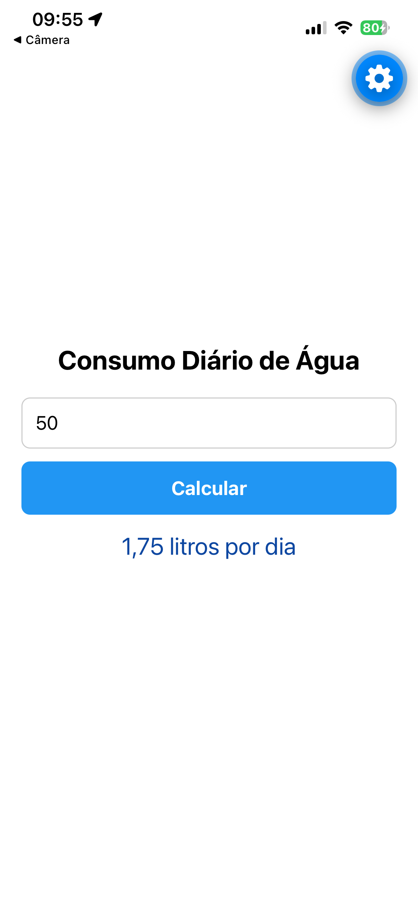

# Questão 01 - Consumo Diário de Água

Calcula a quantidade diária recomendada de água (35 mL por kg de peso corporal).

## Funcionalidades

- Campo para informar o peso (kg)
- Validação de campo vazio, valor inválido, zero ou negativo
- Resultado exibido em litros por dia

## Como executar

1. Acesse [snack.expo.dev](https://snack.expo.dev)
2. Substitua o conteúdo do `App.js` pelo código desta pasta
3. Execute no navegador (Web) ou no celular pelo app **Expo Go**

## Prints da aplicação

**Cálculo para 50 kg: 1,75 litros por dia**

