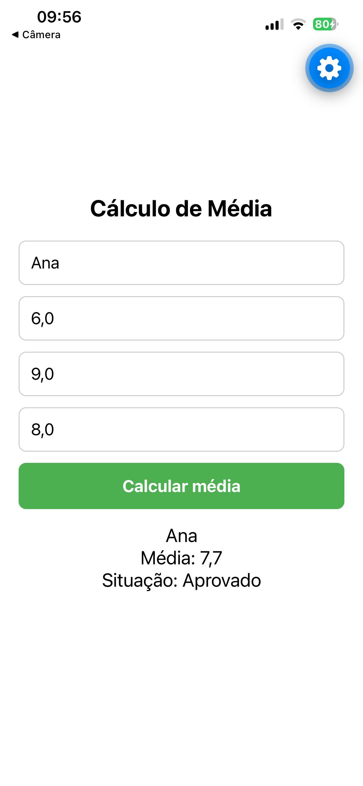

# Questão 02 - Cálculo de Média

Calcula a média aritmética de três notas e informa a situação do estudante.

## Funcionalidades

- Nome do estudante e três notas
- Notas validadas entre 0 e 10
- Aprovado com média ≥ 7, caso contrário Reprovado

## Como executar

1. Acesse [snack.expo.dev](https://snack.expo.dev)
2. Substitua o conteúdo do `App.js` pelo código desta pasta
3. Execute no navegador (Web) ou no celular pelo app **Expo Go**

## Prints da aplicação

**Média 7,7 — Aprovado**

