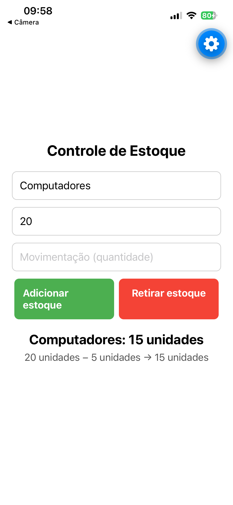
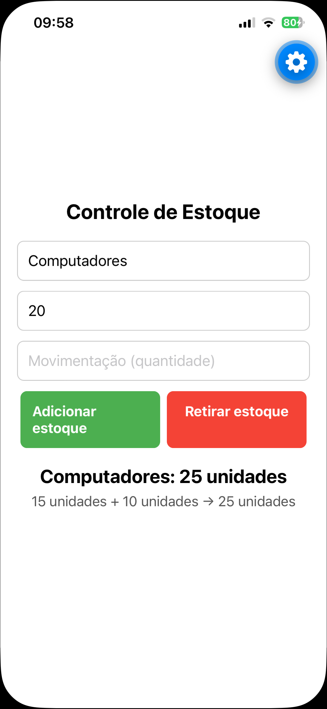

# Questão 03 - Controle de Estoque

Controla a entrada e saída de unidades de um produto.

## Funcionalidades

- Quantidade inicial e movimentações (inteiros)
- Botões de adicionar e retirar estoque
- Impede retirada maior que o disponível
- Alerta quando o estoque fica abaixo de 5 unidades

## Como executar

1. Acesse [snack.expo.dev](https://snack.expo.dev)
2. Substitua o conteúdo do `App.js` pelo código desta pasta
3. Execute no navegador (Web) ou no celular pelo app **Expo Go**

## Prints da aplicação

**Retirada de 5 unidades (20 → 15)**

**Adição de 10 unidades (15 → 25)**

