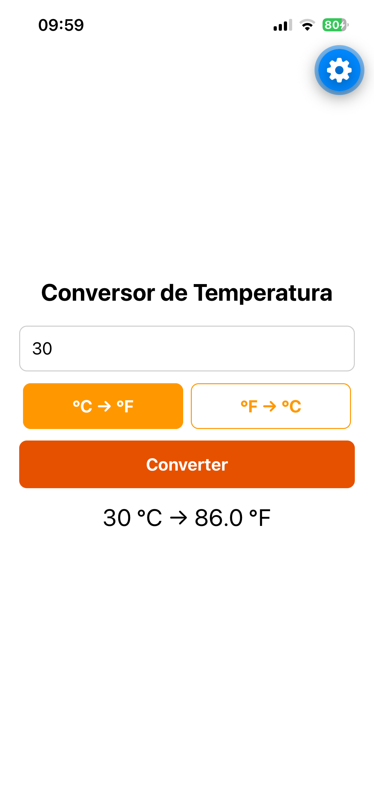
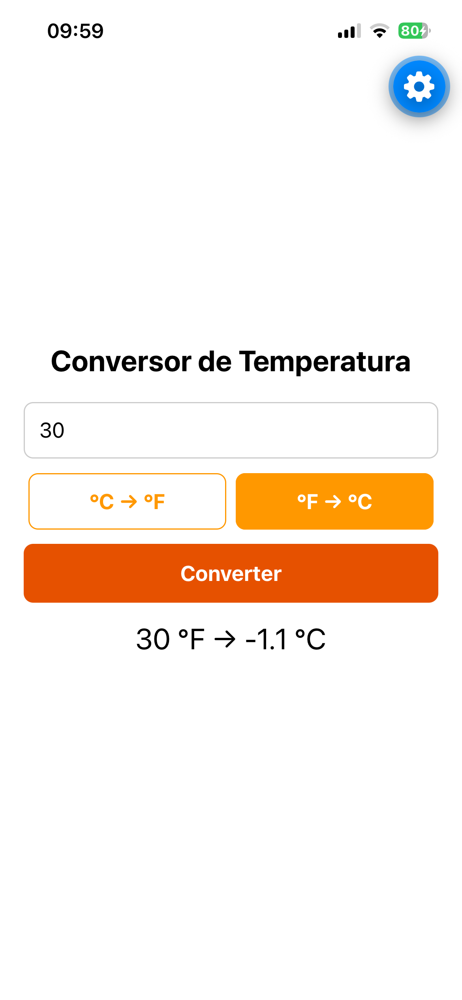

# Questão 04 - Conversor de Temperatura

Converte temperaturas entre Celsius e Fahrenheit.

## Funcionalidades

- Escolha do sentido: °C → °F ou °F → °C
- F = (C × 9/5) + 32 e C = (F − 32) × 5/9
- Validação de valor inválido

## Como executar

1. Acesse [snack.expo.dev](https://snack.expo.dev)
2. Substitua o conteúdo do `App.js` pelo código desta pasta
3. Execute no navegador (Web) ou no celular pelo app **Expo Go**

## Prints da aplicação

**Conversão °C → °F (30 °C = 86,0 °F)**

**Conversão °F → °C (30 °F = -1,1 °C)**

