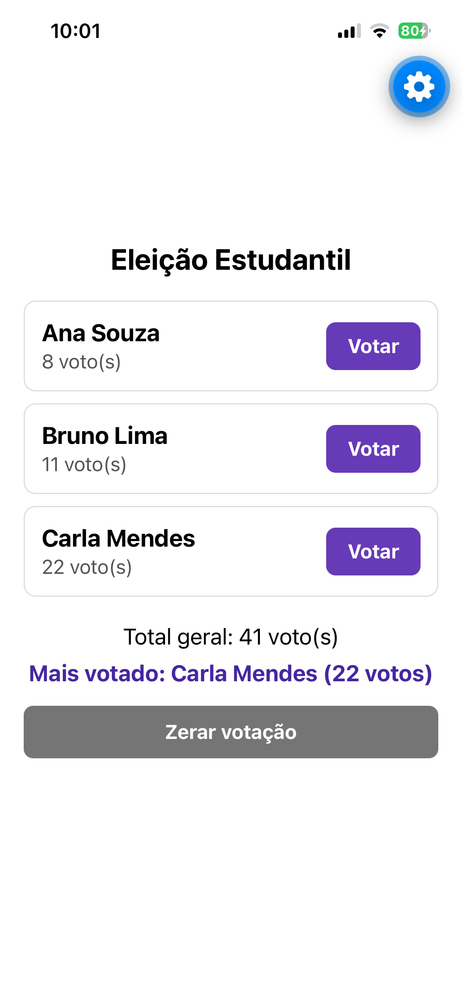

# Questão 06 - Eleição Estudantil

Sistema de votação para três candidatos fictícios.

## Funcionalidades

- Botão de voto para cada candidato
- Total geral de votos
- Exibe o mais votado ou empate na liderança
- Botão para zerar a votação

## Como executar

1. Acesse [snack.expo.dev](https://snack.expo.dev)
2. Substitua o conteúdo do `App.js` pelo código desta pasta
3. Execute no navegador (Web) ou no celular pelo app **Expo Go**

## Prints da aplicação

**Votação com 41 votos — mais votada: Carla Mendes**

