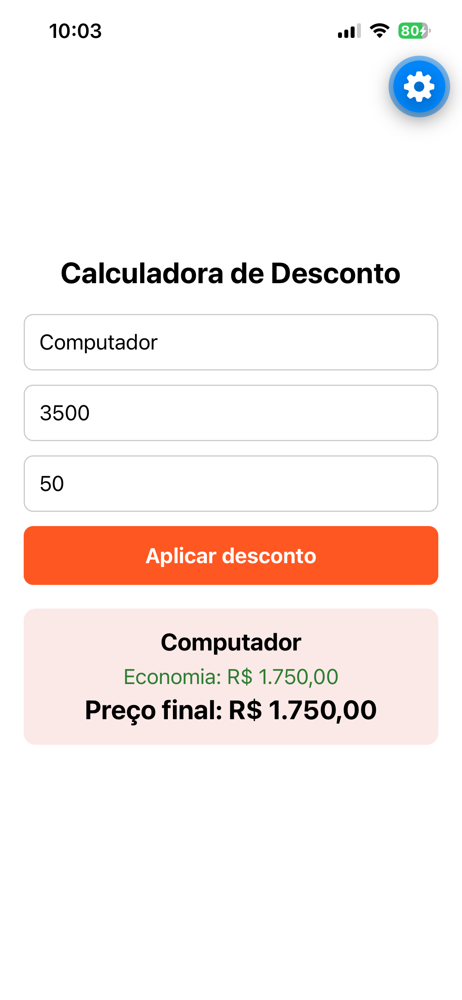

# Questão 07 - Calculadora de Desconto

Calcula o preço final de um produto com desconto percentual.

## Funcionalidades

- Nome do produto, preço e desconto (%)
- Preço não negativo e desconto entre 0% e 100%
- Exibe a economia e o preço final

## Como executar

1. Acesse [snack.expo.dev](https://snack.expo.dev)
2. Substitua o conteúdo do `App.js` pelo código desta pasta
3. Execute no navegador (Web) ou no celular pelo app **Expo Go**

## Prints da aplicação

**Desconto de 50% em produto de R$ 3.500,00**

