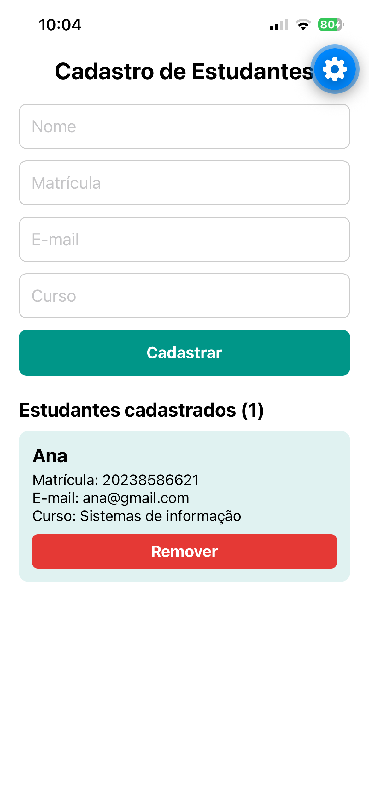

# Questão 08 - Cadastro de Estudantes

Cadastro e consulta de estudantes exibidos em cards.

## Funcionalidades

- Nome, matrícula, e-mail e curso
- Validação de campos obrigatórios e de e-mail
- Impede matrícula duplicada
- Lista em cards com map() e botão de remover

## Como executar

1. Acesse [snack.expo.dev](https://snack.expo.dev)
2. Substitua o conteúdo do `App.js` pelo código desta pasta
3. Execute no navegador (Web) ou no celular pelo app **Expo Go**

## Prints da aplicação

**Estudante cadastrada exibida em card**

