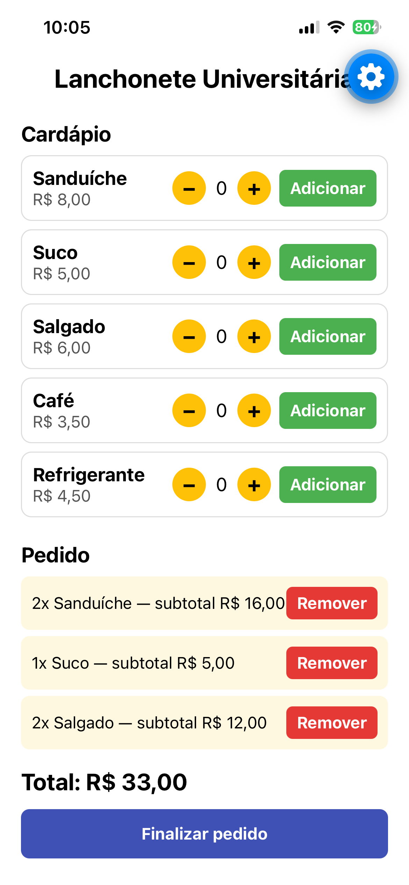
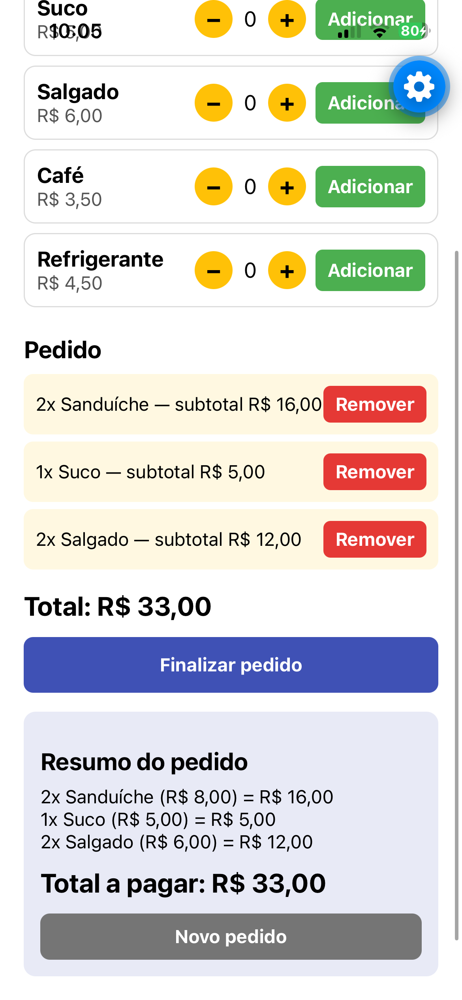

# Questão 09 - Lanchonete

Montagem de pedidos de uma lanchonete.

## Funcionalidades

- Cardápio com cinco produtos
- Seleção de quantidade e adição ao pedido
- Subtotal por item e total do pedido
- Resumo final e opção de novo pedido

## Como executar

1. Acesse [snack.expo.dev](https://snack.expo.dev)
2. Substitua o conteúdo do `App.js` pelo código desta pasta
3. Execute no navegador (Web) ou no celular pelo app **Expo Go**

## Prints da aplicação

**Cardápio e itens do pedido**

**Resumo do pedido finalizado (total R$ 33,00)**

